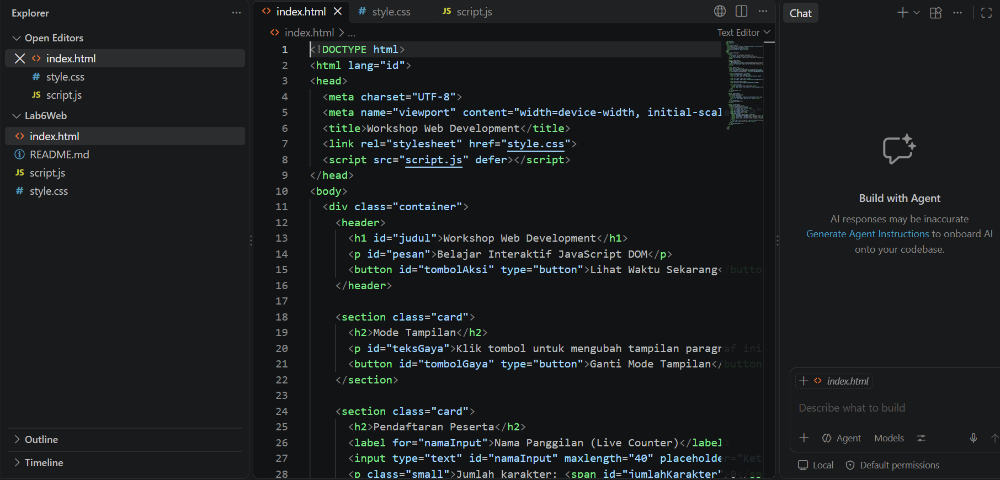

# Lab6Web - Javascript DOM
**Nama : Dyah Triastini**
**NIM : 312510166**
**Mata Kuliah : Pemrograman Web - Lab 6**

### Deskripsi Proyek
Proyek ini adalah implementasi Document Object Model (DOM) menggunakan Javascript untuk membuat form pendaftaran peserta yang interaktif dan dinamis tanpa reload halaman.

### ✨ Fitur Utama
1.  **Form Input Nama:** Mengambil data nama peserta.
2.  **Live Character Counter:** Menghitung jumlah karakter secara real-time menggunakan event `oninput`.
3.  **Toggle Style:** Mengubah gaya tulisan hasil input menggunakan `classList.toggle`.
4.  **Validasi Form:** Validasi agar nama tidak boleh kosong saat daftar.
5.  **Reset Form:** Mengosongkan form dan hasil.

### 💻 Penjelasan Source Code

#### 1. index.html - Struktur Tampilan
Berisi struktur form, input, dan tombol aksi. File ini adalah kerangka utama website.

#### 2. script.js - Logika DOM Javascript
File ini berisi logika utama:
- `document.getElementById` untuk mengambil elemen.
- `addEventListener` untuk interaksi klik dan input.
- Manipulasi DOM untuk menampilkan hasil.

#### 3. style.css - Tampilan
Mengatur desain agar form terlihat rapi, modern, dan responsif di semua device.

### 🖥️ Hasil Tampilan Website

#### Tampilan Awal & Fitur Hitung Karakter
Saat pengguna mengetik, jumlah karakter akan otomatis bertambah.

#### Tampilan Fitur Ganti Gaya & Validasi Pendaftaran

#### Tampilan Hasil Akhir Setelah Berhasil Daftar

